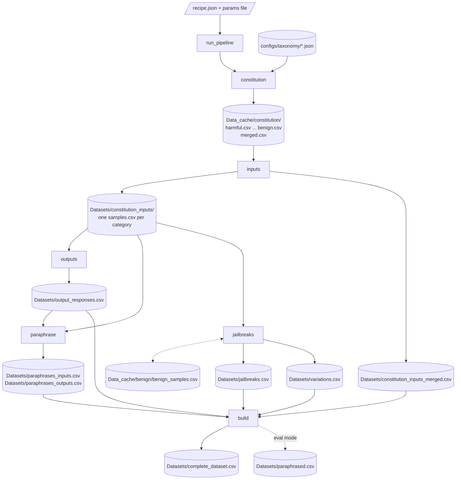

# Overview

REDACT generates red-teaming datasets for content moderation and jailbreak
research. A run takes a taxonomy of categories, generates samples for each
category with an uncensored model, checks every sample with a checker model,
generates model responses, augments the samples with jailbreak techniques and
natural variations, and merges all of it into one CSV.

The library is model-agnostic (hosted APIs or local vLLM engines),
prompt-agnostic (prompts are JSON files under `prompts/`, overridable per
file), and category-agnostic (a new taxonomy is a JSON file). Every stage
writes as it goes and resumes after a crash or a kill.

## The stages

A run is an ordered list of stages. Each stage has one public function, its
**front**, in `stages.py`.

| Stage | Front | What it does | Main output |
|---|---|---|---|
| `constitution` | `generate_constitution` | Per taxonomy category, a hierarchy of constitution categories and sample descriptions at four entry types | `Data_cache/constitution/merged.csv` |
| `inputs` | `generate_inputs` | Checked input samples: seeded from the constitution (training), or from meta-prompts (eval, deprecated) | `Datasets/constitution_inputs/<category>/samples.csv` or `Datasets/<category>/samples.csv` |
| `outputs` | `generate_outputs` | One checked model response per accepted input | `Datasets/output_responses.csv` |
| `paraphrase` | `generate_paraphrases` | Checked paraphrases of the inputs and of the accepted outputs | `Datasets/paraphrases_inputs.csv`, `Datasets/paraphrases_outputs.csv` |
| `jailbreaks` | `generate_jailbreaks` | Jailbreak attacks (adversarial kind) and natural variations (natural kind) of the accepted inputs | `Datasets/jailbreaks.csv`, `Datasets/variations.csv` |
| `build` | `build_dataset` | Merge every stage's rows into one file | `Datasets/complete_dataset.csv` |

Two more fronts are outside the recipe: `generate_conversations` and
`evaluate_conversations` in `multi_turn/`
([stages/conversations.md](stages/conversations.md)).

A recipe's `dataset_type` picks the input path. `training` seeds the inputs
from the constitution. `eval` runs the standalone meta-prompt path and may
not list the `constitution` stage.

## How the files flow

In a recipe run, each stage reads what an earlier stage left on disk, never
what it returned.
Solid arrows are reads and writes of the training path; dotted ones are
optional.



Beside each output CSV a stage keeps a manifest (`*.manifest.jsonl`, the
plan) and a ledger (`*.state.jsonl`, the finished units). The driver writes a
run record per stage (`Datasets/<stage>.run.json`) and the run's trace
(`Datasets/run-<time>.trace.jsonl`). [running.md](running.md#what-lands-on-disk)
lists every file.

## One training run, end to end

This walk follows `src/redact/configs/runs/training_example.json`, which
lists all six stages, with its params file `params_example.json`.

```python
from redact import run_pipeline

summary = run_pipeline("src/redact/configs/runs/training_example.json")
```

### 1. The recipe is loaded and checked

`recipe.load_recipe` reads the JSON and checks it before anything runs:

- `dataset_type` is `eval` or `training`; `eval` may not list `constitution`.
- Each name in `stages` is a key of `STAGES`, listed once.
- No key outside the recipe keys (a key starting with `_` is a comment).
- Each role object under `models` is valid (`recipe.serving_of`).
- The `augmentations` section is resolved over the packaged default
  (`recipe.augmentations_of`), so a bad technique or family name fails here.

`recipe.load_params` reads the params file, resolved against the recipe's
folder. It refuses a `jailbreaks` key that belongs in the augmentation
section.

### 2. The driver sets the run up

`driver.run_pipeline` builds one `RunContext` (data root, models per role,
prompt overlay, taxonomy, params, resolved augmentations, `resume`). Then:

1. `Stage.check` runs for every stage, so a params key that the front does
   not take fails before the first stage spends anything.
2. `telemetry.install` opens the trace file.
3. `report_prompt_sources` logs which prompts the overlay replaces.
4. `capabilities.set_run_serving` makes every client of the run use the
   recipe's `backend_type` and `workers` for each model.
5. `_plan_phases` plans the local models stage by stage, logs each plan and
   hands the planned memory shares and cards to the vLLM loader
   ([running.md](running.md#the-gpu-planner)).

### 3. Each stage runs

For each stage, in the recipe's order, the driver:

1. when the run has local models, enters the stage's phase: unloads the
   engines the stage does not keep, and starts preloading the models it needs
   on a background thread;
2. labels all telemetry inside the stage with its name;
3. calls the front with `read_back=False` and `Stage.kwargs(ctx)`: the
   recipe's values first, then the params file's;
4. counts the rows of the stage's files (`file_counts`);
5. writes `Datasets/<stage>.run.json`.

Each front resolves its models (`ModelClient.create`), its inputs and its
paths, then calls one core. The core plans its units, skips the ones the
ledger records, drives the rest through the model calls, and saves finished
units in batches. [internals/top-level.md](internals/top-level.md#the-seven-steps-of-a-stage)
gives the seven steps every core follows.

**constitution.** `generate_constitution` builds a client for the
`constitution` role (default `claude-opus-4-6`) and calls
`ConstitutionPipeline.run`. One unit per taxonomy category and entry type;
each is one call whose reply parses into entries. Rows go to
`Data_cache/constitution/<entry_type>.csv` and `merged.csv`.
[stages/constitution.md](stages/constitution.md)

**inputs.** In a training run the driver reads the saved constitution
(`read_constitution`) when the stage starts and passes it as
`constitution_df`. `generate_inputs` calls
`InputPipeline.run_from_constitution`: one unit per constitution entry,
asking for `samples_per_entry` samples, each checked by the `check` model.
Rows, accepted and rejected, go to
`Datasets/constitution_inputs/<category>/samples.csv`. The front then copies
the accepted rows of every category into
`Datasets/constitution_inputs_merged.csv` for the build.
[stages/inputs.md](stages/inputs.md)

**outputs.** `generate_outputs` reads the accepted inputs of the run
(`dataset.merge_inputs`) and calls `run_output_generation`: one unit per
input, a response and a check. Rows go to `Datasets/output_responses.csv`.
[stages/outputs.md](stages/outputs.md)

**paraphrase.** `generate_paraphrases` paraphrases the accepted inputs and
the accepted outputs, each target through `run_paraphrase_target`, and checks
each paraphrase with a separate model. [stages/paraphrase.md](stages/paraphrase.md)

**jailbreaks.** `generate_jailbreaks` resolves the two kinds of the
augmentation section and calls `jailbreak.pipeline.run_augmentation` once per
kind that is on: the adversarial kind to `Datasets/jailbreaks.csv`, the
natural kind to `Datasets/variations.csv`. Each call plans every unit first
(one technique combination per input and round, frozen in the manifest), then
drives the units. [stages/jailbreaks.md](stages/jailbreaks.md)

**build.** `build_dataset` copies the rows of every stage's file into
`Datasets/complete_dataset.csv`, in chunks, with a `dataset_type` column per
part. [stages/build.md](stages/build.md)

### 4. The run ends

In a `finally` block the driver clears the run's serving choices, waits for
any preload thread, unloads every local engine, clears the planned shares and
cards, and rolls up telemetry (tokens, engine time, cost). `run_pipeline`
returns a summary: `dataset_type`, `data_dir`, `stages` (counts and record
path per stage), `serving`, `telemetry`, and `residency` and `trace` when
present.

## The final dataset

`complete_dataset.csv` holds the rows of each part, one after another, with
the union of their columns. A row is empty in the columns its part lacks.

| `dataset_type` | From | Rows taken | Text columns |
|---|---|---|---|
| `content_moderation_input` | `constitution_inputs_merged.csv`, else the category files | accepted | `sample` |
| `jailbreak` | `jailbreaks.csv` | all | `prompt` (the input), `jailbreak` |
| `natural_variation` | `variations.csv` | accepted | `prompt`, `jailbreak` |
| `content_moderation_output` | `output_responses.csv` | all | `input_prompt`, `output_response` |
| `content_moderation_paraphrase` | `paraphrases_inputs.csv`, `paraphrases_outputs.csv` | accepted, training mode only | `sample` |

Rows that keep their verdict carry it in `accepted`. Every row has a
`sample_id`, the content id of its own text (a jailbreak error row: of its
unit key), and every derived row has an `input_id`, the `sample_id` of the
input it comes from. The text sits in a different column per part, as the
table shows; [stages/build.md](stages/build.md) has the details.

## An eval run

`eval_example.json` lists `inputs`, `outputs`, `paraphrase`, `jailbreaks`,
`build`. The inputs stage runs the standalone path
([stages/inputs.md](stages/inputs.md#standalone-inputs)): per category it
generates a description and seed prompts (by default), then generates and
checks samples in turns until the category has `samples_per_category`
accepted samples or runs out of turns. It
writes `Datasets/<category>/samples.csv` and warns with a
`DeprecationWarning`. The build runs in `eval` mode: paraphrases go to
`Datasets/paraphrased.csv` instead of the complete dataset.

## Outside the recipe

| Package | What it is for |
|---|---|
| `multi_turn/` | Conversation datasets: a `Setting` of actors played on seeds (`generate_conversations`), scored by a judge (`evaluate_conversations`) |
| `multiturn_attacks/` | A `Setting` of an attacker and a target model (`generate_attacks`, `score_attacks`, `optimize_attack`), built on `multi_turn/` |
| `optimization/` | A beam search over conversation moves scored by a judge (`optimize`) |
| `dataset/loading.py` | Load a published dataset from the HuggingFace Hub (`load_hf_dataset`, `load_from_config`) |
