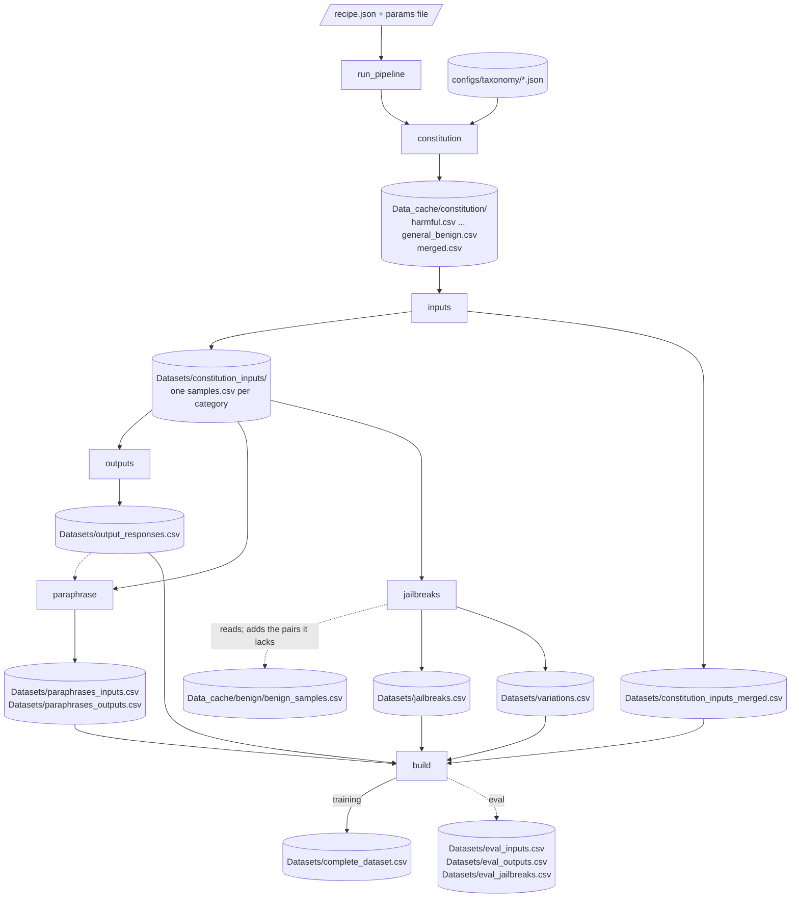

# Overview

REDACT generates red-teaming datasets for content moderation and jailbreak
research. A run takes a taxonomy of categories, generates samples for each
category with an uncensored model, checks every sample with a checker model,
generates model responses, augments the samples with jailbreak techniques and
natural variations, and merges the accepted rows into one CSV for training,
or into three flat files for evaluation.

The library is model-agnostic (hosted APIs or local vLLM engines),
prompt-agnostic (prompts are JSON files under `prompts/`, overridable per
file), and category-agnostic (a new taxonomy is a JSON file). Every stage
writes as it goes and resumes after a crash or a kill.

## The stages

A run is an ordered list of stages. Each stage has one public function, its
**front**, in `stages.py`.

| Stage | Front | What it does | Main output |
|---|---|---|---|
| `constitution` | `generate_constitution` | Per taxonomy category, a hierarchy of constitution categories and sample descriptions at four entry types (two in an eval run), and benign ones per category of the benign taxonomy | `Data_cache/constitution/merged.csv` |
| `inputs` | `generate_inputs` | Checked input samples, seeded from the constitution | `Datasets/constitution_inputs/<category>/samples.csv` |
| `outputs` | `generate_outputs` | k checked model responses per accepted input (1, or 2 in a training run), each in an answer mode | `Datasets/output_responses.csv` |
| `paraphrase` | `generate_paraphrases` | Checked paraphrases of the inputs (and, as an opt-in, of the accepted outputs) | `Datasets/paraphrases_inputs.csv`, `Datasets/paraphrases_outputs.csv` |
| `jailbreaks` | `generate_jailbreaks` | Jailbreak attacks (adversarial kind) and natural variations (natural kind) of the accepted inputs | `Datasets/jailbreaks.csv`, `Datasets/variations.csv` |
| `build` | `build_dataset` | Merge every stage's accepted rows: into one file (training), or into three files of one flat schema (eval) | `Datasets/complete_dataset.csv`; in eval `Datasets/eval_inputs.csv`, `eval_outputs.csv`, `eval_jailbreaks.csv` |

Two more fronts are outside the recipe: `generate_conversations` and
`evaluate_conversations` in `multi_turn/`
([stages/conversations.md](stages/conversations.md)), a planned extension,
not finished.

Every run seeds its inputs from a constitution: the recipe's `constitution`
stage writes it, or an earlier run saved it under `data_dir`. A recipe's
`dataset_type` names a packaged file, `configs/dataset_types/<type>.json`,
that gives the run's default stages, params and augmentation section, and it
picks the build's mode ([configuration.md](configuration.md#dataset-types)).

## How the files flow

In a recipe run, each stage reads what an earlier stage left on disk, never
what it returned.
Solid arrows are reads and writes of the training path; dotted ones are
optional.



Beside each output CSV a stage keeps a manifest (`*.manifest.jsonl`, the
plan) and a ledger (`*.state.jsonl`, the finished units). The driver writes a
run record per stage (`Datasets/<stage>.run.json`) and the run's trace
(`Datasets/run-<time>.trace.jsonl`). [running.md](running.md#what-lands-on-disk)
lists every file.

## One training run, end to end

This walk follows `src/redact/configs/runs/training_example.json`, which
lists all six stages, with its params file `params_training_example.json`.

```python
from redact import run_pipeline

summary = run_pipeline("src/redact/configs/runs/training_example.json")
```

### 1. The recipe is loaded and checked

`recipe.load_recipe` reads the JSON and checks it before anything runs:

- `dataset_type` is given and is `eval` or `training`, whatever files the
  `config_dir` holds; its file under `configs/dataset_types/`, or the
  `config_dir`'s, is read (`recipe.load_dataset_type`). Its `stages` are the
  default, and its params are checked as the params file's are.
- Each name in `stages` is a key of `STAGES`, listed once.
- No key outside the recipe keys (a key starting with `_` is a comment).
- Each key under `models` is a recipe role (a key starting with `_` is a
  comment), and each role object is valid (`recipe.serving_of`).
- `resume` is `true` or `false`.
- The `augmentations` section is resolved over the dataset type's, itself
  over the packaged default (`recipe.augmentations_of`), so a bad technique
  or family name fails here.
- When the constitution stage runs with the general-benign part on in its
  params (the dataset type's, with the params file's over them, read as
  written; `run_pipeline(params=...)` stands in for the file), or the
  jailbreak stage runs a kind that draws a technique needing benign data,
  the `benign_taxonomy` is read and must have a category
  (`recipe.benign_taxonomy_of`).
- A `config_dir`, relative to the recipe, must be a folder.
- A `taxonomy` of the former name `content_moderation_categories` is read as
  `harmful`, with a `DeprecationWarning`.

`recipe.load_params` reads the params file, resolved against the recipe's
folder. It refuses a key that is not a stage name (a key starting with `_`
is a comment), and a `jailbreaks` key that belongs in the augmentation
section.

### 2. The driver sets the run up

`driver.run_pipeline` builds one `RunContext` (data root, dataset type,
models per role, prompt overlay, config folder, taxonomy, benign taxonomy,
params, resolved augmentations, `resume`). Then:

1. `Stage.check` runs for every stage, so a params key that the front does
   not take fails before the first stage spends anything. `check_dimensions`
   then stops a run in which a generation axis that varies and a family the
   augmentation section draws share a dimension
   ([configuration.md](configuration.md#dimensions-and-the-runs-check)).
2. `telemetry.install` opens the trace file.
3. `report_prompt_sources` logs which prompts the overlay replaces, and
   `report_config_sources` which config files the `config_dir` replaces,
   warning about those it cannot and naming the packaged natural families
   its copy of `augmentations.json` does not allow.
4. `capabilities.set_run_serving` makes every client of the run use the
   recipe's `backend_type` and `workers` for each model.
5. `_plan_phases` plans the local models stage by stage, logs each plan and
   hands the planned memory shares and cards to the vLLM loader
   ([running.md](running.md#the-gpu-planner)).
6. `_check_cards` reads `nvidia-smi` once and stops the run, before any
   model loads, when another process holds memory on a card the plan uses.

### 3. Each stage runs

For each stage, in the recipe's order, the driver:

1. when the run has local models, enters the stage's phase: unloads the
   engines the stage does not keep, and starts preloading the models it needs
   on a background thread;
2. labels all telemetry inside the stage with its name;
3. calls the front with `read_back=False` and `Stage.kwargs(ctx)`: the
   recipe's values first, then the stage's params, the dataset type's with
   the params file's over them;
4. counts the rows of the stage's files (`file_counts`);
5. writes `Datasets/<stage>.run.json`, with the files the stage read in
   `sources`, and the dataset type and its file's hash.

Leaving the stage, telemetry logs per model how many replies were cut at the
token limit in it.

Each front resolves its models (`ModelClient.create`), its inputs and its
paths, then calls one core. The core plans its units, skips the ones the
ledger records, drives the rest through the model calls, and saves finished
units in batches. [internals/top-level.md](internals/top-level.md#the-seven-steps-of-a-stage)
gives the seven steps every core follows.

**constitution.** `generate_constitution` builds a client for the
`constitution` role (default `claude-opus-4-6`) and calls
`ConstitutionPipeline.run`. One unit per taxonomy category and entry type,
and one per category of the benign taxonomy for the general-benign part;
each is one call whose reply parses into entries. Rows go to
`Data_cache/constitution/<entry_type>.csv` (`general_benign.csv` for the
general-benign part) and `merged.csv`.
[stages/constitution.md](stages/constitution.md)

**inputs.** When the stage starts, the driver reads the constitution saved
under `data_dir` (`read_constitution`) and passes it as `constitution_df`,
in an eval run as in a training one; without one the stage stops with
`No constitution at ...`. `generate_inputs` calls
`InputPipeline.run_from_constitution`: `samples_per_entry` units per
constitution entry, each dealt a spec of the generation axes and asking for
one sample, checked by the `check` model.
Rows, accepted and rejected, go to
`Datasets/constitution_inputs/<category>/samples.csv`. The front then copies
the accepted rows of every category into
`Datasets/constitution_inputs_merged.csv` for the build.
[stages/inputs.md](stages/inputs.md)

**outputs.** `generate_outputs` reads the accepted inputs of the run
(`dataset.merge_inputs`) and calls `run_output_generation`:
`outputs_per_input` units per input (2 in a training run), each dealt an
answer mode its entry type allows (`harmful` or `helpful`, which picks the
prompt and the checker and gives the response its label), then a spec of
the response axes, a response and a check. Rows go to
`Datasets/output_responses.csv`.
[stages/outputs.md](stages/outputs.md)

**paraphrase.** `generate_paraphrases` paraphrases the accepted inputs (and,
as an opt-in, the accepted outputs), each target through
`run_paraphrase_target`, and checks each paraphrase with a separate model. [stages/paraphrase.md](stages/paraphrase.md)

**jailbreaks.** `generate_jailbreaks` resolves the two kinds of the
augmentation section and calls `jailbreak.pipeline.run_augmentation` once per
kind that is on: the adversarial kind to `Datasets/jailbreaks.csv`, the
natural kind to `Datasets/variations.csv`. Each call plans every unit first
(one technique combination per input and round, frozen in the manifest, with
what the plan was made with in `<kind>.plan.json`, which a resume checks),
then drives the units. [stages/jailbreaks.md](stages/jailbreaks.md)

**build.** `build_dataset` copies the accepted rows of every stage's file
into `Datasets/complete_dataset.csv`, in chunks, with a `dataset_type` column
per part. A row whose `sample_id` an earlier part wrote is left out, and the
count left out is logged. An eval run's build writes three files of one
flat schema instead (below). [stages/build.md](stages/build.md)

### 4. The run ends

In a `finally` block the driver clears the run's serving choices. When the
run has local models it waits at most 60 seconds for a preload still
running, unloads the engines the run loaded (those loaded before it, such as
a notebook's, stay), and clears the planned shares and cards. It then rolls
up telemetry (tokens, engine time, cost). `run_pipeline`
returns a summary: `dataset_type`, `data_dir`, `stages` (counts and record
path per stage), `serving`, `telemetry` (with `cut`, the replies cut at the
token limit per stage and model), and `residency` and `trace` when present.

## The dataset of a training run

`complete_dataset.csv` holds the accepted rows of each part, one after
another, with the union of their columns. A row is empty in the columns its
part lacks. Rejected and error rows stay in the stage files. A row whose
`sample_id` an earlier part wrote is left out: an adversarial no-op is its
input, and a variation can be a jailbreak's text.

| `dataset_type` | From | Rows taken | Text columns |
|---|---|---|---|
| `content_moderation_input` | `constitution_inputs_merged.csv`, else the category files | accepted | `sample` |
| `jailbreak` | `jailbreaks.csv` | accepted | `prompt` (the input), `jailbreak` |
| `natural_variation` | `variations.csv` | accepted | `prompt`, `jailbreak` |
| `content_moderation_output` | `output_responses.csv` | accepted | `input_prompt`, `output_response` |
| `content_moderation_paraphrase` | `paraphrases_inputs.csv`, `paraphrases_outputs.csv` | accepted | `sample` |

Every row has a `sample_id`, the content id of its own text, and every
derived row has an `input_id`, the `sample_id` of the input it comes from. The text sits in a different column per part, as the
table shows; [stages/build.md](stages/build.md) has the details.

## An eval run

`eval_example.json` names `"dataset_type": "eval"` and a small constitution
(one category of each taxonomy and three constitution categories per unit,
`params_eval_example.json`); the eval type file gives the rest. It runs the same
six stages as a training run, with these differences:

- the constitution and the inputs take only the `harmful` and `benign` entry
  types, the clear ends, beside the general-benign part both types build
  from the benign taxonomy;
- the jailbreak stage attacks the harmful inputs only, with a pool of hard
  techniques whose label stays certain (five heavy encodings, `fsh` and
  `dap` less their many-shot variants, `framing`, `structural`,
  `ascii_art`, `continuation`, `temporal`, `to_refusal_then_comply` and
  eight low-resource translations), one technique then two, with seed 43,
  and makes no natural variations;
- the build runs in `eval` mode and writes no complete dataset: it writes
  three files with one `text` and one `label` column each, so an evaluation
  reads them without a join.

| File | Rows | `label` |
|---|---|---|
| `eval_inputs.csv` | the accepted inputs, then their paraphrases (`paraphrased` true) | the entry type |
| `eval_outputs.csv` | the accepted responses, then their paraphrases (when the outputs were paraphrased) | `<entry_type>_<output_label>`: the entry type of the input answered, then `harmful` or `benign` for the response's answer mode (an `output_label` column holds the second part) |
| `eval_jailbreaks.csv` | the accepted attacks that changed their input (`is_jailbreak` true), then the bare benign inputs (`is_jailbreak` false) | the entry type |

The variations are in none of them. Every row keeps its `sample_id`, and
a derived row its `input_id`, as in a training run's files. A training run
and an eval run use two `data_dir`s; the eval build's `exclude_from` names
the training run: the rows it holds by id or text are left out, those
from a constitution entry it has too are kept and flagged, and both are
counted.

## Outside the recipe

| Package | What it is for |
|---|---|
| `multi_turn/` | Conversation datasets: a `Setting` of actors played on seeds (`generate_conversations`), scored by a judge (`evaluate_conversations`); a planned extension, not finished |
| `multiturn_attacks/` | A `Setting` of an attacker and a target model (`generate_attacks`, `score_attacks`, `optimize_attack`), built on `multi_turn/`; a planned extension, not finished |
| `optimization/` | A beam search over conversation moves scored by a judge (`optimize`); a planned extension, not finished |
| `dataset/loading.py` | Load a published dataset from the HuggingFace Hub (`load_hf_dataset`, `load_from_config`) |

## Out of scope

Two parts of the work live in separate repositories:

- **Defingerprinting**: the reverse-paraphraser training and the fingerprint
  removal model. This library calls a paraphraser model (the `paraphraser`
  role) but does not train one.
- **Prompt optimization**: the automatic prompt finetuner, which reads and
  writes prompt JSON files in this library's schema.

## Safety and ethics

REDACT is built for defensive AI safety research: datasets to evaluate and
improve content moderation and jailbreak detection.

- Handle generated data responsibly. Clear `Datasets/` and `Data_cache/`
  before sharing a working root.
- The inputs, the outputs and the paraphrases are checked by a second model,
  which rejects low-quality and off-category samples.
